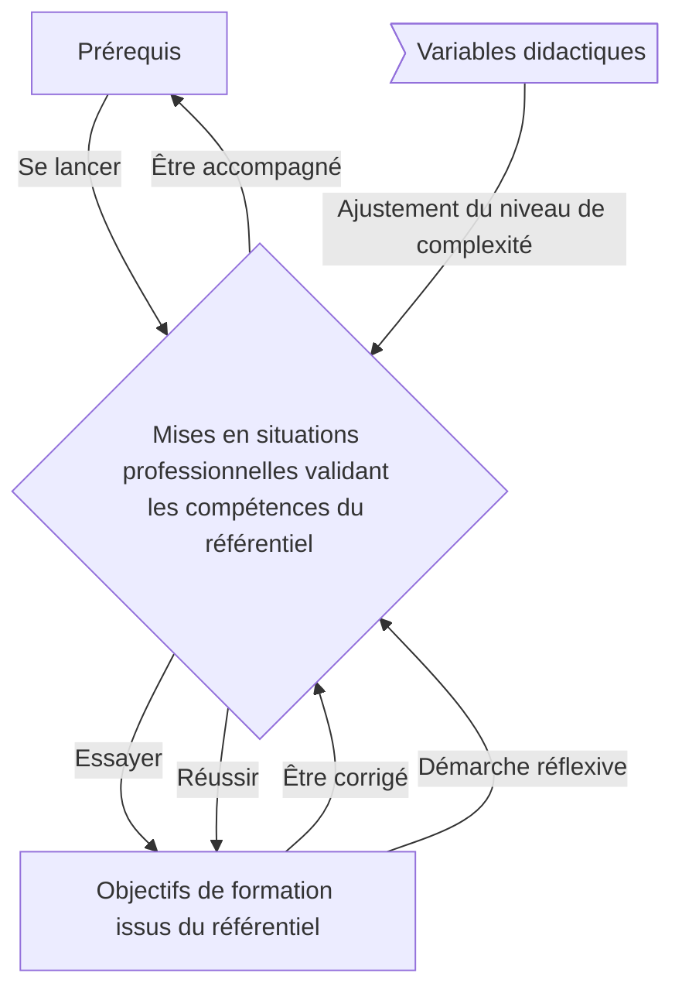
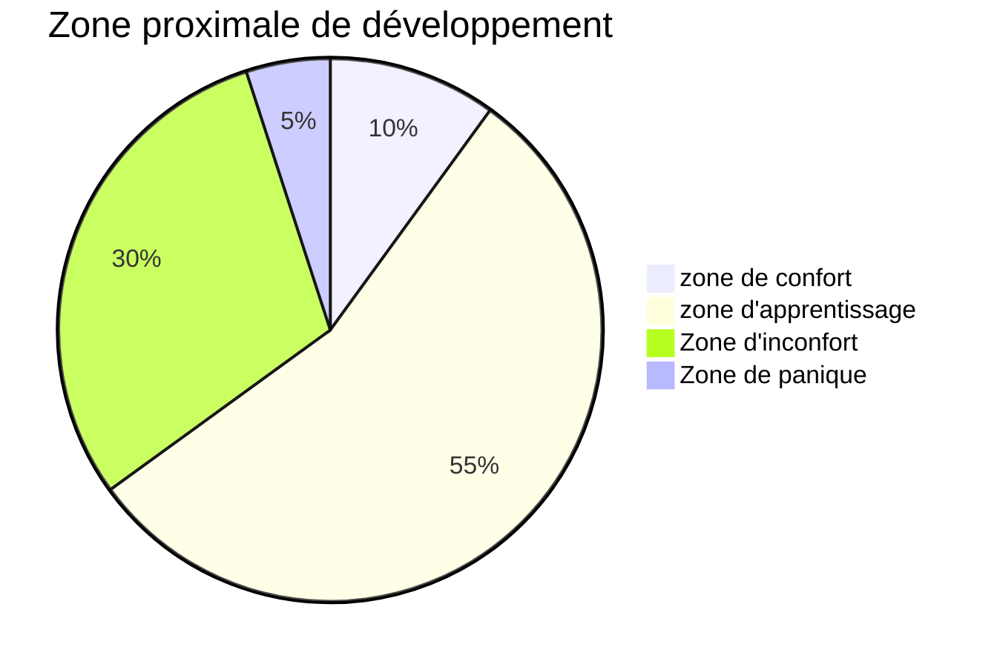

# Apprentissage & Mises en Situation Professionnelle (MESP)

  <a href="../README.md">🏠 Retour à l'accueil Dojo-101</a> •
  <a href="https://github.com/sponsors/Aif4thah/">💖 Soutenir le projet sur GitHub Sponsors</a>

> [!TIP]
> **👨‍🏫 Vous êtes formateur, enseignant ou responsable pédagogique en école / ESN ?**
> Ces **38 Mises en Situation Professionnelle (MESP)** sont le fruit d'années d'ingénierie pédagogique et d'animation de formations Cybersécurité & DevSecOps. Si vous les utilisez pour vos promotions ou vos travaux pratiques, **[soutenez officiellement Dojo-101 sur GitHub Sponsors 💖](https://github.com/sponsors/Aif4thah/)** (et affichez le logo de votre école ou organisme sur la page d'accueil du dépôt !).

## Organisation des mises en situations professionnelles (Catalogue des 38 MESP)

* **0x : Introduction & Méthodologie**
  * [01 - Préparation d'une soutenance avec dossier](./01-MESP-Soutenance.md)
  * [02 - Initiation à la classification des vulnérabilités](./02-MESP-Initiation-Vuln.md)
  * [03 - Utiliser une base de connaissance (Dojo-101 & Git)](./03-MESP-Dojo-101.md)

* **1x : Mise en place du Lab et des tools**
  * [10 - Mettre en place un environnement de test (Lab)](./10-MESP-Creation-Lab.md)

* **2x : Initiation aux protocoles, scripting et outils de sécurité**
  * [20 - Implémenter une baseline sur une machine Windows](./20-MESP-Baseline-Windows.md)
  * [21 - Analyser la sécurité du trafic réseau](./21-MESP-Traffic-reseau.md)
  * [22a - Initiation au scripting OS](./22-MESP-Scripting-OS.md)
  * [22b - Scripter l'analyse de trafic Réseau et Web](./22-MESP-Scripting-Web.md)

* **3x : Réseaux, VPN, nomadisme & Cloud**
  * [30 - Mise en place d'un VPN](./30-MESP-Conf-VPN.md)
  * [33 - Zero Trust et sécurisation d'une machine nomade](./33-MESP-Nomadisme-Zero-Trust.md)
  * [34 - Mettre en production une solution réseau](./34-MESP-Mise-en-prod-reseau.md)

* **4x : Audit & Pentest**
  * [40 - Audit de sécurité d'un OS Windows en environnement AD](./40-MESP-Audit-Conf-Windows.md)
  * [41 - Audit de sécurité d'un OS Linux](./41-MESP-Audit-Conf-Linux.md)
  * [42 - Audit de code / Pentest Boîte Blanche](./42-MESP-Audit-Code-Pentest.md)

* **5x : DevSecOps, Microservices & GitHub**
  * [50 - Déploiement sécurisé d'un container Docker](./50-MESP-Docker-microservice.md)
  * [51 - Audit de sécurité GitHub](./51-MESP-Audit-Github.md)
  * [52 - DevSecOps Post-Audit / Pentest](./52-MESP-DevSecOps-Post-Audit.md)

* **6x : Hardening & Supervision (SIEM)**
  * [60 - Hardening / Durcissement Windows & Linux](./60-MESP-Hardening-Windows-Linux.md)
  * [62 - Durcissement de la configuration SSH](./62-MESP-Hardening-SSH.md)
  * [64 - Configurer le pare-feu sur une machine Linux](./64-MESP-firewall-linux.md)
  * [65 - Configurer le pare-feu sur une machine Windows](./65-MESP-firewall-Windows.md)
  * [68 - Journalisation (Logs) & SIEM](./68-MESP-Logs-SIEM.md)

* **7x : Gouvernance, Gestion des risques et des menaces**
  * [70 - Réaliser une analyse de risque EBIOS RM](./70-MESP-EBIOS-RM.md)
  * [71 - Mise en œuvre SMSI / ISO 27001](./71-MESP-27001.md)
  * [72 - Threat Modeling (Modélisation des menaces)](./72-MESP-Threat-modeling.md)

* **8x : Wireless & Radiofréquences (RF / SDR)**
  * [80a - Initiation à la cryptographie et au SDR (Morse)](./80-MESP-SDR-Crypto-Morse.md)
  * [80b - Initiation au SIGINT](./80-MESP-SDR-SIGINT.md)
  * [81 - Initiation au TEMPEST](./81-MESP-SDR-TEMPEST.md)
  * [82 - Satellites et GPS Spoofing](./82-MESP-SDR-Satellite.md)
  * [83 - Sécurité des réseaux sans fil (Wi-Fi)](./83-MESP-SDR-Wifi.md)
  * [85a - Initiation RFID / NFC](./85-MESP-SDR-RFID.md)
  * [85b - Leurre et usurpation (Spoofing) RF](./85-MESP-SDR-Usurapation-RF.md)

* **9x : Hacking, Forensique & Sujets avancés**
  * [90 - WarGame (Attaque / Défense) & Forensic](./90-MESP-Wargame-Forensic.md)
  * [91 - Construire une VM vulnérable](./91-MESP-VM-vulnérables.md)
  * [92 - Découverte des attaques sur la couche 2 OSI](./92-MESP-Attack-L2.md)
  * [93 - Utiliser un Reverse Shell](./93-MESP-ReverseShell.md)
  * [94 - Investigation OSINT](./94-MESP-OSINT.md)
  * [95 - Capture The Flag (CTF)](./95-MESP-CTF.md)

## Schéma de l'Apprentissage

### En distanciel

Pour que l'apprentissage en distanciel fonctionne, il faut

* Participer
* Rester concentré (pas de distraction)
* Faire appel au formateur si on n’arrive pas à trouver de solution après avoir cherché par soi-même
* Mettre la caméra lors des moments d'échange
* Prendre des pauses (si possible sans écran)

## Zone proximale de développement

`zone de confort` -> `zone d'apprentissage` -> `Zone d'inconfort` -> `Zone de panique`

* On vise la **zone d'apprentissage**

* De temps en temps on peut revenir en **zone de confort** pour donner confiance

* Certains apprenants ont besoin d'être poussés ponctuellement en **zone d'inconfort**

* Lorsqu'on pense être en **Zone de panique** il est nécessaire d'en discuter avec le formateur.

## Principe de *Compétence*

Savoir agir en situation.

### Notions de *profondeur des compétences*

* S'acquiert

* Applicable

* Évaluable en s'appuyant sur des critères

* Reconnue par les pairs

### Principe de la *pédagogie active*

On préfère l'expérience et la mise en situation aux cours magistraux.

## Principe d'*approche par compétences*

1. identifier les **situations pro**

2. construire leurs simulations / situations d'apprentissage

3. accompagner l'apprenant dans son action

4. accompagner la démarche réflexive de l'apprenant

## Principe de *variable didactique*

* Elles sont déterminées par le formateur (et non laissée au choix des apprenants) afin de déterminer le niveau de compétence à valider

* Elles diffèrent d'une variable contextuelle: élément sur lequel on ne pourra pas jouer lors de la situation d'apprentissage

## Situation emblématique

`situation professionnelle réelle` -> `situation emblématique` -> `situations d'Apprentissage`

Attention à bien partir d'une `Situation emblématique` et des `Compétences du référentiel` pour couvrir toutes les compétences.

## Montée en compétences

Les `variables didactiques` permettent d'augmenter la complexité.

1. imiter

2. adapter

3. transposer

Objectif: tout niveau 3 pour être certifié, **Critère du REAC = Niveau 3**

## Principe d'analyses réflexives

1. Réfléchissement : Identifier gestes, actions, faiblesses et se projeter éventuellement dans une action future, actuelle ou passée.

2. Analyse réflexive : Vérifier le niveau de compréhension

3. Meta analyse : provoquer un processus d'amélioration continue

---

  <b>💡 Vous utilisez ces scénarios pédagogiques pour vos cours ou votre montée en compétences ?</b> 
  Soutenez la maintenance et l'évolution de <b>Dojo-101</b> en <a href="https://github.com/sponsors/Aif4thah/">devenant Sponsor sur GitHub 💖</a> ou en ajoutant une ⭐ au <a href="https://github.com/Aif4thah/Dojo-101">dépôt principal</a>.

