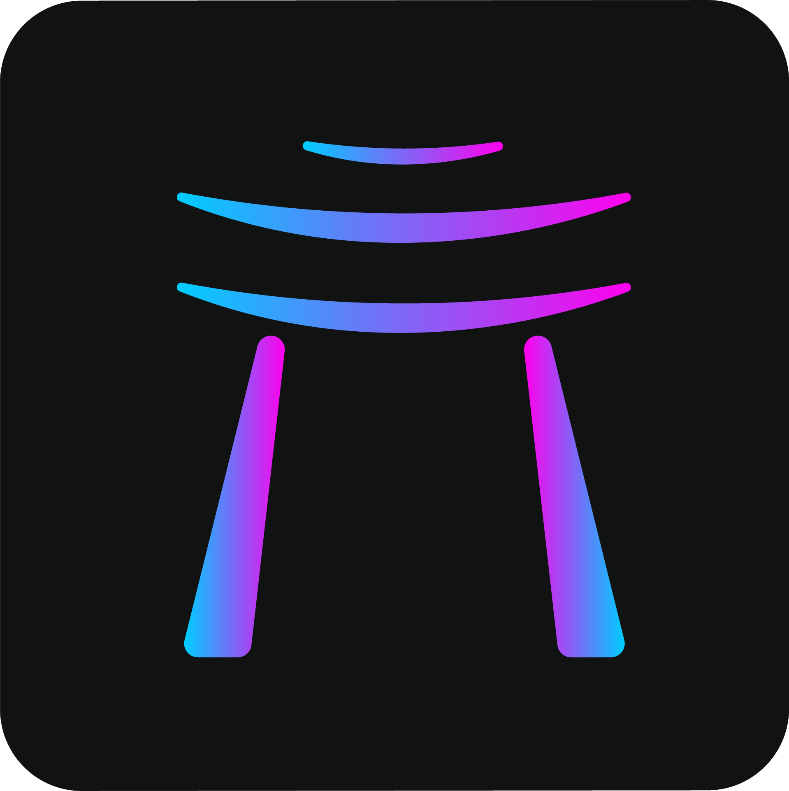
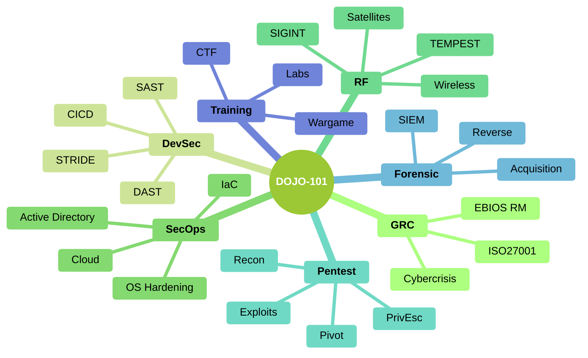

# Dojo-101

<p align="center">
  
  <br>
  <b>DOJO-101 : Base de Connaissances Cybersécurité, DevSecOps & Labs Pédagogiques (Offline-First)</b>
  <br>
  <i>+250 fiches pratiques, Cheat-Sheets & 38 Mises en Situation Professionnelle (MESP) prêtes à l'emploi</i>
</p>

<p align="center">
  <a href="https://github.com/sponsors/Aif4thah/">
    
  </a>
  <a href="https://github.com/Aif4thah/Dojo-101/stargazers">
    
  </a>
</p>

<p align="center">
  <a href="https://www.gnu.org/licenses/gpl-3.0">
    
  </a>
  <a href="https://github.com/Aif4thah/Dojo-101/pulls">
    
  </a>
  
  
</p>

<p align="center">
  <a href="#-thèmes--les-7-piliers">⚔️ Les 7 Piliers</a> •
  <a href="#-par-où-commencer-fondamentaux">👉 Fondamentaux</a> •
  <a href="./Dojo-101-Apprentissage/README.md">🎓 38 Labs & MESP</a> •
  <a href="#-utiliser-dojo-101-hors-ligne">📒 Usage Hors-Ligne</a> •
  <a href="#-soutenir-dojo-101--devenir-sponsor">💖 Devenir Sponsor</a>
</p>

---

> [!TIP]
> **Vous êtes formateur cyber, école d'ingénieurs, pentester ou ingénieur DevSecOps ?**
> Ce dépôt capitalise des années de terrain et d'ingénierie pédagogique (**250+ fiches techniques** et **38 scénarios de travaux pratiques évaluables**). S'il vous fait gagner du temps en mission ou en cours, **[soutenez sa maintenance sur GitHub Sponsors 💖](https://github.com/sponsors/Aif4thah/)**.

## ⚔️ Thèmes & Les 7 Piliers

| Pilier | Contenu & Cas d'usage | Volume | Accès direct |
| :--- | :--- | :---: | :--- |
| **🛡️ DevSecOps & AppSec** | Intégration CI/CD, SAST/DAST (CodeQL, Nuclei, SonarQube, ZAP), ASVS, STRIDE, sécurité par langage (Python, Rust, C, C#, JS, Flutter) | **33 fiches** | [Explorer DevSec](./Dojo-101-DevSec/README.md) |
| **⚙️ SecOps & Hardening** | Fondamentaux SSI, durcissement Linux/Windows/AD, Cloud Azure, Docker, Pare-feu, VPN (WireGuard, OpenVPN), PKI, TLS, SELinux | **31 fiches** | [Explorer SecOps](./Dojo-101-SecOps/README.md) |
| **🎯 Pentest & Red Team** | Méthodologie d'audit, Reconnaissance, Exploitation Web (SQLi, XSS, XXE, SSTI, JWT), Active Directory (Kerberos, BloodHound, Mimikatz), PrivEsc Linux/Windows, Buffer Overflow, Pivot | **127 fiches** | [Explorer Pentest](./Dojo-101-Pentest/README.md) |
| **🔍 Forensic & DFIR** | Réponse à incident, collecte de preuves, mémoire (Volatility), forensique Windows/Linux/Android, Reverse (Ghidra, Radare2), SIEM & parsing de logs (`jq`/`yq`) | **10 fiches** | [Explorer Forensic](./Dojo-101-Forensic/README.md) |
| **📡 Radiofréquences (RF & SDR)** | SDR (HackRF, RTL-SDR, GNU Radio), modulations, SIGINT, TEMPEST, Wi-Fi, Bluetooth, RFID/NFC, TETRA, Satellites & Drones | **17 fiches** | [Explorer RF](./Dojo-101-RF/README.md) |
| **⚖️ Gouvernance, Risques & Conformité (GRC)** | Homologation ANSSI, ISO 27001, EBIOS RM, Cyber Resilience Act (CRA), NIS2, PASSI, Souveraineté, Gestion de crise cyber | **2 dossiers complets** | [Explorer Governance](./Dojo-101-Governance/README.md) |
| **🎓 Apprentissage & Scénarios Pro (MESP)** | **38 Mises en Situation Professionnelle** progressives (Lab, Hardening, Audit, DevSecOps, EBIOS RM, SDR, Wargame, CTF) et guide d'ingénierie pédagogique | **39 fiches** | [Explorer les 38 MESP](./Dojo-101-Apprentissage/README.md) |



## 👉 Par où commencer ? (Fondamentaux)

Les fichiers `README.md` de chaque dossier ainsi que les fiches comportant le mot-clé `basics` constituent les prérequis recommandés avant d'aborder les scénarios avancés :

* 🇫🇷 [Les fondamentaux de la cybersécurité (Cyber basics)](./Dojo-101-SecOps/README.md)
* 🐧 [Linux basics](./Dojo-101-SecOps/Linux-Basics.md) & [Windows basics](./Dojo-101-SecOps/Windows-basics.md)
* 💻 [PowerShell basics](./Dojo-101-SecOps/Powershell-basics.md) & [Python basics](./Dojo-101-DevSec/Python-basics.md)
* 🌐 [Réseau basics](./Dojo-101-SecOps/Basics-reseau.md) & [Wi-Fi basics](./Dojo-101-RF/Wifi-basics.md)
* 🔧 [GitHub basics](./Dojo-101-DevSec/Github-basics.md) & [AI / ML basics](./Dojo-101-DevSec/IA-ML-basics.md)
* 🎓 [Découvrir Dojo-101 en TP (MESP 03)](./Dojo-101-Apprentissage/03-MESP-Dojo-101.md)

## 📒 Utiliser Dojo-101 hors-ligne

Conçu pour être consultable **sans connexion Internet** (en salle blanche, en audit interne, en examen ou en déplacement) :

```sh
git clone --depth 1 https://github.com/Aif4thah/Dojo-101
```

Ouvrez ensuite le dossier `Dojo-101` avec [VSCode](https://code.visualstudio.com/) :

* Recherchez instantanément par mot-clé dans les +250 fiches (`Ctrl` + `Shift` + `F`, ex. `Kerberos`, `GPO`, `EBIOS`, `HackRF`).
* Affichez le rendu visuel et les schémas Mermaid au format HTML (`Ctrl` + `Shift` + `V`).

## 🧪 Tester vos compétences en conditions réelles

Développée en parallèle pour accompagner les fiches Pentest, DevSecOps et les MESP, cette application volontairement vulnérable vous permet de pratiquer en toute légalité :

* 🎯 **[VulnerableLightApp](https://github.com/Aif4thah/VulnerableLightApp)** — Application d'entraînement à l'audit de code, au pentest Web et à la remédiation.

---

## 💖 Soutenir Dojo-101 / Devenir Sponsor

Maintenir plus de **250 fiches techniques à jour**, vérifier les commandes, documenter les nouvelles normes (CRA, NIS2, EBIOS RM) et concevoir des scénarios pédagogiques réalistes représente **des centaines d'heures de travail bénévole**.

Choisissez la formule qui correspond à votre usage sur **[GitHub Sponsors](https://github.com/sponsors/Aif4thah/)** :

| Votre profil | Ce que Dojo-101 vous apporte | Comment soutenir |
| :--- | :--- | :--- |
| **👨‍🎓 Étudiant, Pentester, DevSecOps** | Un aide-mémoire fiable pendant vos CTF, vos audits, vos soutenances ou votre veille quotidienne, 100 % gratuit et sans publicité. | **[Offrir un café ponctuel ou mensuel sur GitHub Sponsors ☕](https://github.com/sponsors/Aif4thah/)** (ou ajouter une ⭐ au dépôt) |
| **👨‍🏫 Formateur indépendant / Enseignant** | **38 MESP clés en main**, des schémas Mermaid prêts à projeter et une structure REAC/compétences qui vous épargnent des semaines de préparation de cours. | **[Devenir Sponsor Formateur sur GitHub 💖](https://github.com/sponsors/Aif4thah/)** et orienter les prochaines mises à jour et traductions |
| **🏢 École Cyber, Organisme de formation, ESN** | Une base pédagogique éprouvée pour vos promotions et une **visibilité directe auprès d'étudiants et professionnels cyber qualifiés** (recrutement & marque employeur). | **[Devenir Sponsor Officiel (Logo sur cet accueil) 🏆](https://github.com/sponsors/Aif4thah/)** |

> 🌍 *Note for English-speaking visitors: Most advanced regulatory and pedagogical sheets are currently in French. Translation and new modules are prioritized based on [GitHub Sponsors](https://github.com/sponsors/Aif4thah/) feedback and requests.*

### 🌟 Nos Sponsors & Partenaires

*Vous souhaitez voir votre nom ou le logo de votre école / entreprise apparaître ici ? [Rejoignez les sponsors de Dojo-101 sur GitHub](https://github.com/sponsors/Aif4thah/) !*

---

## 🤝 Contributions & Sécurité

* **Contribuer** : Vous souhaitez partager un retour d'expérience ou corriger une fiche ? Consultez les [règles de contribution (CONTRIBUTING.md)](./CONTRIBUTING.md).
* **Sécurité** : Consultez notre [politique de sécurité (SECURITY.md)](./SECURITY.md).

## 🏆 Crédits

* **Merci** à l'ensemble des contributeurs, apprenants et sponsors qui font vivre ce projet 😍
* Logo réalisé par [@designbyzen](https://www.designbyzen.fr/)
* Projet créé et maintenu par **[Michael Vacarella (@Aif4thah)](https://github.com/Aif4thah)** — [Soutenir sur GitHub Sponsors 💖](https://github.com/sponsors/Aif4thah/)

> [!WARNING]
> **Avertissement légal / Disclaimer** : Ce dépôt et les outils ou commandes qui y sont documentés sont fournis « en l'état » (*as is*), à des fins strictement pédagogiques, d'audit autorisé et de sécurisation des systèmes d'information. L'auteur décline toute responsabilité en cas d'utilisation illégale, non éthique ou non autorisée. Il appartient à chaque utilisateur de s'assurer de la conformité de ses actions avec les lois et réglementations en vigueur (notamment les articles 323-1 et suivants du Code pénal).
