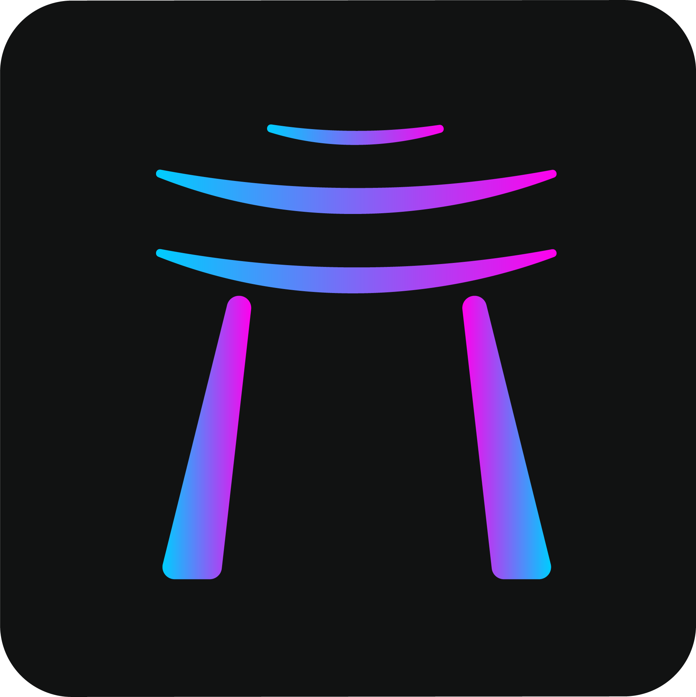
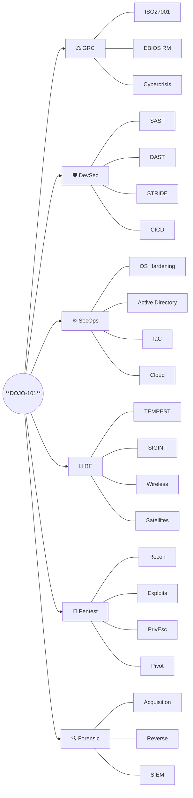

# Dojo-101

<p align="center">
  
  <br>
  <b>DOJO-101 : Base de Connaissances Opérationnelle Cybersécurité, DevSecOps & IA Souveraine (Offline-First)</b>
  <br>
  <i>+210 fiches pratiques de terrain, Cheat-Sheets & Briques de connaissances pour Praticiens et Agents IA</i>
</p>

<p align="center">
  <a href="mailto:michael.vacarella@pm.me">
    
  </a>
  <a href="https://github.com/sponsors/Aif4thah/">
    
  </a>
  <a href="https://github.com/Aif4thah/Dojo-101/stargazers">
    
  </a>
</p>

<p align="center">
  <a href="https://www.gnu.org/licenses/gpl-3.0">
    
  </a>
  <a href="https://github.com/Aif4thah/Dojo-101/pulls">
    
  </a>
  
  
</p>

<p align="center">
  <a href="#-thèmes--les-6-piliers">⚔️ Les 6 Piliers</a> •
  <a href="#-usages--hors-ligne--intégration-ia">🤖 Usages & Agents IA</a> •
  <a href="#-par-où-commencer-fondamentaux">👉 Fondamentaux</a> •
  <a href="#-prestations--audit-cyber--cadrage-ia-souveraine">🛡️ Audit & Conseil</a> •
  <a href="#-soutenir-dojo-101--devenir-sponsor">💖 Devenir Sponsor</a>
</p>

---

> [!TIP]
> **Deux façons d'interagir avec Dojo-101 :**
>
> * 🛡️ **Vous êtes dirigeant, ONG/association, PME souveraine, éditeur logiciel ou DPO/RSSI ?** Besoin d'un audit de code/IaC, d'un pentest ciblé ou d'un cadrage IA souveraine au forfait ? **[Consultez les offres d'intervention](#-prestations--audit-cyber--cadrage-ia-souveraine)** ou **[contactez-moi directement par e-mail](mailto:michael.vacarella@pm.me)**.
> * ⚡ **Vous êtes pentester, ingénieur DevSecOps, architecte cyber ou utilisateur d'agents IA ?** Ce dépôt capitalise des années d'expérience opérationnelle (**+210 fiches techniques vérifiées**). S'il vous fait gagner du temps en mission, **[soutenez sa maintenance sur GitHub Sponsors 💖](https://github.com/sponsors/Aif4thah/)**.

## ⚔️ Thèmes & Les 6 Piliers

| Pilier | Contenu & Cas d'usage | Volume | Accès direct |
| :--- | :--- | :---: | :--- |
| **🛡️ DevSecOps & AppSec** | Intégration CI/CD, SAST/DAST (CodeQL, Nuclei, SonarQube, ZAP), ASVS, STRIDE, sécurité par langage (Python, Rust, C, C#, JS, Flutter) | **33 fiches** | [Explorer DevSec](./Dojo-101-DevSec/README.md) |
| **⚙️ SecOps & Hardening** | Fondamentaux SSI, durcissement Linux/Windows/AD, Cloud Azure, Docker, Pare-feu, VPN (WireGuard, OpenVPN), PKI, TLS, SELinux | **31 fiches** | [Explorer SecOps](./Dojo-101-SecOps/README.md) |
| **🎯 Pentest & Red Team** | Méthodologie d'audit, Reconnaissance, Exploitation Web (SQLi, XSS, XXE, SSTI, JWT), Active Directory (Kerberos, BloodHound, Mimikatz), PrivEsc Linux/Windows, Buffer Overflow, Pivot | **127 fiches** | [Explorer Pentest](./Dojo-101-Pentest/README.md) |
| **🔍 Forensic & DFIR** | Réponse à incident, collecte de preuves, mémoire (Volatility), forensique Windows/Linux/Android, Reverse (Ghidra, Radare2), SIEM & parsing de logs (`jq`/`yq`) | **10 fiches** | [Explorer Forensic](./Dojo-101-Forensic/README.md) |
| **📡 Radiofréquences (RF & SDR)** | SDR (HackRF, RTL-SDR, GNU Radio), modulations, SIGINT, TEMPEST, Wi-Fi, Bluetooth, RFID/NFC, TETRA, Satellites & Drones | **17 fiches** | [Explorer RF](./Dojo-101-RF/README.md) |
| **⚖️ Gouvernance, Risques & Conformité (GRC)** | Homologation ANSSI, ISO 27001, EBIOS RM, Cyber Resilience Act (CRA), NIS2, PASSI, Souveraineté, Gestion de crise cyber | **2 dossiers complets** | [Explorer Governance](./Dojo-101-Governance/README.md) |



## 🤖 Usages : Hors-ligne & Intégration IA

### 1. Base de connaissances pour Agents IA & Workflows d'Audit

Le formatage uniforme en Markdown brut (`.md`), sans fioritures ni dépendances propriétaires, et le fichier d'indexation [`llms.txt`](./llms.txt) rendent ce dépôt directement exploitable par vos environnements d'intelligence artificielle :

* **Contexte pour agents de code et d'audit** : indexable nativement par vos outils (Claude Code, Google Antigravity, Cursor, GitHub Copilot) pour appuyer des tâches de revue de code, de durcissement IaC, de scripting ou de pentest.
* **Alimentation de compétences personnalisées (Skills / Rules / RAG)** : les fiches servent de briques méthodologiques prêtes à l'emploi pour cadrer des agents autonomes ou des pipelines RAG sans prétraitement.
* **Doctrine Local-First & Souveraineté** : 100 % compatible avec des modèles d'IA locaux ou auto-hébergés (*air-gapped*), garantissant la confidentialité absolue du code source et des données d'audit.

### 2. Consultation hors-ligne (Air-gapped)

Conçu pour être consultable **sans connexion Internet** (en salle blanche, en audit sur réseau isolé ou en déplacement) :

```sh
git clone --depth 1 https://github.com/Aif4thah/Dojo-101
```

Ouvrez ensuite le dossier `Dojo-101` avec [VSCode](https://code.visualstudio.com/) ou [Obsidian](https://obsidian.md/) :

* Recherchez instantanément par mot-clé dans les +210 fiches (`Ctrl` + `Shift` + `F`, ex. `Kerberos`, `GPO`, `EBIOS`, `HackRF`).
* Affichez le rendu visuel et les schémas Mermaid au format HTML (`Ctrl` + `Shift` + `V`).

## 👉 Par où commencer ? (Fondamentaux)

Les fichiers `README.md` de chaque dossier ainsi que les fiches comportant le mot-clé `basics` constituent les points d'entrée recommandés :

* 🇫🇷 [Les fondamentaux de la cybersécurité (Cyber basics)](./Dojo-101-SecOps/README.md)
* 🐧 [Linux basics](./Dojo-101-SecOps/Linux-Basics.md) & [Windows basics](./Dojo-101-SecOps/Windows-basics.md)
* 💻 [PowerShell basics](./Dojo-101-SecOps/Powershell-basics.md) & [Python basics](./Dojo-101-DevSec/Python-basics.md)
* 🌐 [Réseau basics](./Dojo-101-SecOps/Basics-reseau.md) & [Wi-Fi basics](./Dojo-101-RF/Wifi-basics.md)
* 🔧 [GitHub basics](./Dojo-101-DevSec/Github-basics.md) & [AI / ML basics](./Dojo-101-DevSec/IA-ML-basics.md)

## 🧪 Banc d'essai applicatif (Audit & Remédiation)

Développée en parallèle pour accompagner les fiches Pentest et DevSecOps, cette application volontairement vulnérable permet de tester vos outils SAST/DAST, vos agents d'audit et vos correctifs en toute légalité :

* 🎯 **[VulnerableLightApp](https://github.com/Aif4thah/VulnerableLightApp)** — Application de test pour l'audit de code, le pentest Web et la validation de remédiations.

---

## 🛡️ Prestations : Audit Cyber & Cadrage IA Souveraine

Au-delà de ce référentiel open-source, j'accompagne les **organisations à impact (ONG, fondations, associations, ESS)**, les **PME/ETI souveraines**, les **éditeurs logiciels** ainsi que les **DPO et RSSI externes** sur des missions techniques à forte valeur ajoutée.

**Approche opérationnelle** : 100 % au forfait, en asynchrone (télétravail intégral), sans réunion quotidienne inutile, propulsée par l'orchestration d'agents IA et la méthodologie **Dojo-101**.

| Offre d'intervention (Forfait) | Périmètre technique & Livrables |
| :--- | :--- |
| **1. 🔍 Audit Flash Cyber & Code / IaC « IA-First »** | Revue de code source, audit de configuration Cloud/IaC et pentest applicatif ciblé sur périmètre fermé (dépôt Git, application Web/Mobile, API).<br>**Livrables** : Rapport d'audit actionnable + correctifs prêts à intégrer + séance de restitution en visio. |
| **2. 🤖 Cadrage « IA Souveraine & DevSecOps »** | Déploiement d'une architecture de développement et d'usage IA sécurisée basée sur **Dojo-101** : prévention des fuites de secrets, durcissement des pipelines CI/CD, doctrine *Local-First* et cadrage d'agents IA sans compromis sur votre souveraineté. |
| **3. ⚖️ Diagnostic Conformité & Relais Prescripteurs** | Pré-audit documentaire à blanc sur pièces (**EBIOS RM, ISO 27001, NIS2, CRA, exigences PASSI**).<br>**Partenariat B2B** : Relais technique pour DPO externes, DSI/RSSI à temps partagé et cabinets de conformité. |

### Protocole d'intervention en 4 étapes

1. **Cadrage écrit** : Définition précise du périmètre technique par écrit, sans longs appels commerciaux.
2. **Engagement forfaitaire** : Validation de la proposition forfaitaire et planification du sprint.
3. **Sprint d'hyperfocus** : Exécution technique isolée assistée par agents IA et référentiel Dojo-101 (zéro friction pour vos équipes).
4. **Livraison & Restitution** : Remise du rapport actionnable, des correctifs et tenue de la visio de restitution.

### 📩 Me contacter pour une mission ou un partenariat

* **E-mail direct** : **[michael.vacarella@pm.me](mailto:michael.vacarella@pm.me)**
* **Profil & Parcours** : **[LinkedIn — Michael Vacarella](https://www.linkedin.com/in/mvacarella/)**

---

## 💖 Soutenir Dojo-101 / Devenir Sponsor

Maintenir plus de **210 fiches techniques à jour**, vérifier les commandes, documenter les nouvelles normes (CRA, NIS2, EBIOS RM) et structurer ce référentiel pour les agents IA représente **des centaines d'heures de R&D et de capitalisation**.

Choisissez la formule qui correspond à votre usage sur **[GitHub Sponsors](https://github.com/sponsors/Aif4thah/)** :

| Votre profil | Ce que Dojo-101 vous apporte | Comment soutenir |
| :--- | :--- | :--- |
| **🛠️ Pentester, DevSecOps, Ingénieur Cyber** | Un aide-mémoire opérationnel fiable pour vos audits, votre veille et une base structurée (`llms.txt`) prête à enrichir vos agents IA locaux, 100 % gratuit et sans pub. | **[Offrir un café ponctuel ou mensuel sur GitHub Sponsors ☕](https://github.com/sponsors/Aif4thah/)** (ou ajouter une ⭐ au dépôt) |
| **🤖 Équipe Tech, Startup IA, Cabinet DPO / RSSI** | Un référentiel francophone rigoureux (DevSecOps, Hardening, GRC, NIS2/CRA) pour outiller vos ingénieurs et cadrer vos assistants IA internes. | **[Devenir Sponsor Professionnel sur GitHub 💖](https://github.com/sponsors/Aif4thah/)** et orienter les prochaines mises à jour |
| **🏢 PME Souveraine, Éditeur Logiciel, ESN** | Un bien commun numérique ouvert qui élève le niveau de sécurité de l'écosystème et une **visibilité directe auprès de praticiens et décideurs cyber** (marque employeur & engagement open-source). | **[Devenir Sponsor Officiel (Logo sur cet accueil) 🏆](https://github.com/sponsors/Aif4thah/)** |

### 🌟 Nos Sponsors & Partenaires

*Vous souhaitez voir votre nom ou le logo de votre organisation apparaître ici ? [Rejoignez les sponsors de Dojo-101 sur GitHub](https://github.com/sponsors/Aif4thah/) !*

---

## 🤝 Contributions & Sécurité

* **Contribuer** : Vous souhaitez partager un retour d'expérience opérationnel ou corriger une fiche ? Consultez les [règles de contribution (CONTRIBUTING.md)](./CONTRIBUTING.md).
* **Sécurité** : Consultez notre [politique de sécurité (SECURITY.md)](./SECURITY.md).

## 🏆 Crédits

* **Merci** à l'ensemble des contributeurs, praticiens et sponsors qui font vivre ce projet 😍
* Logo réalisé par [@designbyzen](https://www.designbyzen.fr/)
* Projet créé et maintenu par **[Michael Vacarella (@Aif4thah)](https://github.com/Aif4thah)** — [LinkedIn](https://www.linkedin.com/in/mvacarella/) • [Me contacter](mailto:michael.vacarella@pm.me) • [Soutenir sur GitHub Sponsors 💖](https://github.com/sponsors/Aif4thah/)

> [!WARNING]
> **Avertissement légal / Disclaimer** : Ce dépôt et les outils ou commandes qui y sont documentés sont fournis « en l'état » (*as is*), à des fins exclusives d'audit de sécurité autorisé, d'homologation et de durcissement des systèmes d'information. L'auteur décline toute responsabilité en cas d'utilisation illégale, non éthique ou non autorisée. Il appartient à chaque utilisateur de s'assurer de la conformité de ses actions avec les lois et réglementations en vigueur (notamment les articles 323-1 et suivants du Code pénal).
